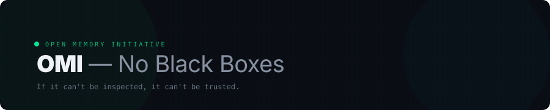

<picture>
  <source media="(prefers-color-scheme: dark)" srcset="https://raw.githubusercontent.com/The-Open-Memory-Initiative-OMI/.github/main/assets/omi-banner-dark.svg">
  <source media="(prefers-color-scheme: light)" srcset="https://raw.githubusercontent.com/The-Open-Memory-Initiative-OMI/.github/main/assets/omi-banner-light.svg">
  
</picture>

## This organisation is an archive

The Open Memory Initiative ran here from December 2025 to November 2026. The work continues, with a wider scope, at **[Pactolus Microelectronics](https://github.com/Pactolus-Microelectronics)**: open memory, open tooling and open chips.

Everything here is kept as it was, so that links to it keep working and the record stays whole.

## What was built here

| Project | What it is | Where it stood when this became an archive |
|---|---|---|
| [`omi`](https://github.com/The-Open-Memory-Initiative-OMI/omi) | A reference design for an 8 GB DDR4 UDIMM, built from public sources only, with the reasoning written down. | **Schematic only** (release v1.1.0). It passes the electrical rule check with [0 violations](https://github.com/The-Open-Memory-Initiative-OMI/omi/blob/main/exports/erc.json) and has a generated netlist, parts list and PDF. Decoupling, termination and the SPD device were open items. No board layout was made and no board was built. The design continues as [`ddr4-udimm`](https://github.com/Pactolus-Microelectronics/ddr4-udimm). |
| [`spdr`](https://github.com/Pactolus-Microelectronics/spdr) | A read-only decoder and linter for DDR5 SPD data, written in Rust. | **Released** on [crates.io](https://crates.io/crates/spdr). It started here and moved to Pactolus Microelectronics in November 2026, where it is maintained. Its old address redirects. |

A correction to the record: earlier versions of this page and of the v1.1.0 release notes called the DDR4 schematic "complete". It is complete as a connectivity schematic that passes its rule check. It is not a finished design.

> **No black boxes.** If it can't be inspected, it can't be trusted.

Independent learning and reference work by a single maintainer, [Mert Efe Şensoy](https://github.com/mertefesensoy). Not affiliated with, or the same as, the industry "Open Memory Interface (OMI)" serial-memory standard.

Hardware is under CERN-OHL-S-2.0, code under Apache-2.0 and documents under CC-BY-SA-4.0, as stated in each repository.
